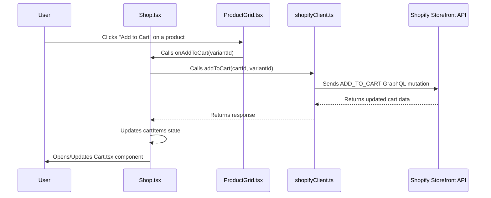

# Shopify Integration Documentation

This document outlines the Shopify integration within the JLB Profile application, including its architecture, data flow, and styling setup.

## 1. Overview

The application integrates with Shopify to provide e-commerce functionality, allowing users to browse products, add them to a cart, and proceed to a Shopify-hosted checkout. The integration primarily uses the Shopify Storefront API via GraphQL.

## 2. Activation

The shop feature is conditionally rendered in the application based on an environment variable.

*   **Environment Variable**: `VITE_STORE_ACTIVE`
*   **File**: `.env` (at the root of the project)
*   **Usage**: Set `VITE_STORE_ACTIVE=true` in your `.env` file to enable the shop link in the navigation and the `/shop` route.

The visibility of the shop is controlled in `src/App.tsx`:
```typescript
// src/App.tsx
const storeActive = import.meta.env.VITE_STORE_ACTIVE === 'true';

// ... later in the component
{storeActive && <Link to="/shop" className="nav-link">Shop</Link>}

// ... and for routes
{storeActive && <Route path="/shop" element={<Shop />} />}
```

## 3. Architecture and Data Flow

The integration follows a client-server model where the React frontend communicates directly with the Shopify Storefront API.

### High-Level Architecture

```mermaid
graph TD
    A[User Browser (React App)] --> B(Shopify Client Utility<br>`src/utils/shopifyClient.ts`);
    B --> C{Shopify Storefront API<br>(GraphQL)};
    C --> D[Shopify Backend];

    subgraph "Frontend Application (jlb-profile)"
        A
        B
    end
```

### Data Flow: Adding to Cart



## 4. Core Components

### `src/utils/shopifyClient.ts`
This is the central module for interacting with the Shopify Storefront API.
- **Initialization**: It uses `graphql-request` to create a `GraphQLClient` instance.
  - Endpoint: `VITE_STOREFRONT_API` (from `.env`)
  - Access Token: `VITE_STOREFRONT_ACCESS_TOKEN` (from `.env`)
- **Key Functions**:
  - `queryProducts()`: Fetches a list of products.
  - `createCart()`: Creates a new shopping cart session.
  - `addToCart(cartId, variantId)`: Adds a product variant to the specified cart.
- **GraphQL Operations**: Defines GraphQL queries and mutations (e.g., `QUERY_PRODUCTS`, `CREATE_CART`, `ADD_TO_CART`).

### `src/pages/Shop.tsx`
This page component serves as the main interface for the shop.
- **State Management**: Manages state for products, cart ID, cart items, checkout URL, loading status, and errors using `useState`.
- **Initialization (`useEffect`)**:
  - Calls `createCart()` to get a `cartId` and `checkoutUrl`.
  - Calls `queryProducts()` to fetch and display products.
- **Functionality**:
  - `handleAddToCart(variantId)`: Adds items to the cart and updates the cart state.
  - Renders `ProductGrid` to display products.
  - Renders `Cart` component and controls its visibility.

### `src/components/Cart.tsx`
This component displays the current shopping cart.
- **Props**: Receives `items`, `checkoutUrl`, `isOpen`, and `onClose`.
- **Functionality**:
  - Lists cart items with details (image, title, price, quantity).
  - Calculates and displays the total price.
  - Provides a "Checkout" link that redirects to the `checkoutUrl` (Shopify's checkout page).
  - Includes an image resizing utility `getResizedImageUrl` for Shopify images.

### `src/types/shopify.ts`
This file defines TypeScript interfaces for Shopify-related data structures, ensuring type safety.
- **Key Interfaces**: `ShopifyProduct`, `ShopifyVariant`, `ShopifyImage`, `CartItem`.

## 5. Styling Setup

The application employs a dual approach to styling:

### Tailwind CSS
- **Primary Framework**: Tailwind CSS is used for most of the utility-first styling.
- **Configuration**: `tailwind.config.js` is standard, without extensive customizations.
  ```javascript
  // tailwind.config.js
  export default {
    content: [
      "./index.html",
      "./src/**/*.{js,ts,jsx,tsx}",
    ],
    theme: {
      extend: {},
    },
    plugins: [],
  }
  ```
- **Usage**: Utility classes are applied directly in the JSX of components (e.g., `Shop.tsx`, `Cart.tsx`).

### `src/App.css`
This file contains global styles, custom CSS, and styles for elements not easily managed by utility classes alone.
- **Global Styles**:
  - Sets a base dark theme: `body { background-color: #121212; color: white; }`.
  - Defines default typography: `font-family: "Anonymous Pro", "PT Mono", "Courier New", monospace;`.
- **Component-Specific Styles**:
  - Styles for general layout (`.app`, `.content-container`), header, navigation, profile picture, etc.
  - Custom styles for the cart, such as `.cart-overlay` for the slide-in panel and `.cart-item` for individual item styling.
  ```css
  /* src/App.css example for cart */
  .cart-overlay {
    position: fixed;
    /* ... other styles ... */
    transform: translateX(100%);
    transition: transform 0.3s ease-in-out;
  }

  .cart-overlay.open {
    transform: translateX(0);
  }
  ```
- **Responsive Design**: Includes `@media` queries for adapting styles on smaller screens.

## 6. Key GraphQL Operations (in `src/utils/shopifyClient.ts`)

- **`QUERY_PRODUCTS`**: Fetches product details (ID, title, description, price, images, variants).
  ```graphql
  query GetProducts {
    products(first: 10) {
      // ... fields ...
    }
  }
  ```
- **`CREATE_CART`**: Creates a new cart and returns its ID and checkout URL.
  ```graphql
  mutation CreateCart {
    cartCreate {
      cart {
        id
        checkoutUrl
      }
    }
  }
  ```
- **`ADD_TO_CART`**: Adds lines to an existing cart.
  ```graphql
  mutation AddToCart($cartId: ID!, $variantId: ID!) {
    cartLinesAdd(
      cartId: $cartId
      lines: [{ quantity: 1, merchandiseId: $variantId }]
    ) {
      cart {
        // ... fields ...
      }
    }
  }
  ```

This document should provide a solid understanding of the Shopify integration. For more specific details, refer to the source code files mentioned.
